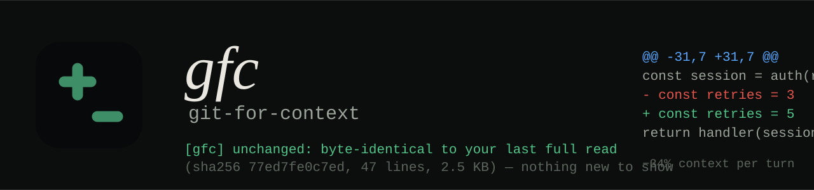

# GFC — git-for-context

<p align="center"></p>

<p align="center">
  <a href="https://github.com/jjjebli/gfc/actions/workflows/ci.yml"></a>
  <a href="#measured"></a>
  <a href="package.json"></a>
  
  
</p>

**Docs site: https://jjjebli.github.io/gfc/** — the interactive version: scrolly chapters that walk the mechanism, an A/B read simulator (with vs without GFC), and animated benchmark bars.

## In plain words

An AI coding agent has a short-term memory: the conversation. Every time it
reads a file, the whole file is pasted into that memory, and the agent pays
for every word in it on every turn after that. Agents re-read the same files
constantly, so the memory fills with copies of things it already has.

GFC sits between the agent and the files and keeps a little notebook of what
the agent has already read in this conversation (a fingerprint of each file,
not a copy of your code in the conversation). When the agent asks again:

- **Nothing changed?** GFC answers *"you already have this, it hasn't
  changed"* — one sentence instead of the whole file.
- **Something changed?** GFC sends only the lines that changed, with line
  numbers, instead of the whole file again.
- **First time, or the agent lost it?** The agent gets the real file. When the
  conversation gets summarised (compaction), GFC wipes its notebook for that
  conversation, and the agent can always get the full file by simply asking
  again.

Like `git` sends you a diff instead of the whole repository, GFC sends the
model a diff instead of the whole file. Same answers, smaller memory, lower
bill.

## What the model sees

| What the model does | What it gets |
|---|---|
| First read of a file | The real content (always) |
| Re-reads an **unchanged** file — or unchanged lines of a large one | A short `[GFC] unchanged` note (~70 tokens, with the content hash) |
| Re-reads a **changed** file | A numbered diff: only the lines that changed |
| Asks for the same thing again right after a note | **Always** the real content (the escape hatch) |
| Reads anything after **compaction** | Real content again |

The rule GFC is built around: **a note never points at content the model
doesn't have.** Every note tells the model how to get the real thing back.

## Works with

| Harness | How GFC plugs in | What it handles |
|---|---|---|
| **OpenCode** | plugin on the `read` tool | stubs (per page), numbered diffs, compaction |
| **Codex** | hooks on shell reads (`sed -n`, `cat`, `nl -ba`, `head`) | stubs, numbered diffs, compaction |
| **Claude Code** | hooks on shell reads + learns from `Read` | stubs and diffs for `cat`/`sed` reads; its own `Read` tool already dedups natively, so GFC leaves `Read` output alone |
| **Any MCP client** (Cursor, Gemini CLI, Windsurf…) | `gfc_read` tool | stubs, diffs, paging; the model has to choose `gfc_read` |

Model-agnostic: GFC only changes tool *results*, never prompts, so it works the
same with Claude, GPT, Gemini or open models. Zero per-turn overhead in
OpenCode, Codex and Claude Code — no tools added, no prompt additions; nothing
happens unless a repeated read was about to happen.

## Measured

72-run A/B benchmark on opencode free-tier models (3 models × 4 scenarios × 3 reps,
fresh sessions, all attempts counted, no outlier removal). Full protocol in `bench/`.

| Scenario | Per-turn context (arm A → arm B) | Delta |
|---|---|---|
| Re-read 2000-line file (nemotron-3-ultra) | 66,230 → 43,410 | **−34%** |
| Edit + re-read (nemotron-3-ultra) | 66,392 → 43,597 | **−34%** |
| Re-read (step-5-preview) | 44,839 → 34,908 | **−22%** |
| Re-read (ling-3.1-flash) | 58,702 → 43,521 | **−26%** |
| Small files / first reads | unchanged | 0% (by design) |

Mechanism fired 9/9 in every valid run. Comprehension after a stub: 100%
(models answer content questions from their first read; benchmark found zero
re-fetch side-effects). Registry writes are cross-process safe (lockfile +
atomic rename; verified by a 2-process race test — 60/60 entries survive).

The win scales with the size of your files and how often the agent re-reads
them. A 2000-line file re-read twice costs ~3× in tokens; with GFC it costs
~1.05×.

*The A/B numbers above were measured on v0.1.* v0.2 extends the mechanism to
cases v0.1 passed through untouched — re-reads of files over 50 KB (which
OpenCode pages) and multi-site edits (which v0.1 re-sent in full). On a
deterministic replay of OpenCode 1.19's read output (a 40 KB file re-read and
edited in two places, plus a 95 KB file re-read twice), context drops 33% with
v0.1 and 62% with v0.2. For the Claude Code / Codex shell hook, a replay of a
typical Codex reading session (10 `sed -n` / `nl -ba` / `cat` reads of two
files, chunked first look, re-checks, a two-place edit) drops from 185k to
62k characters (−67%). These replays count characters, not model behaviour;
re-run `bench/` for model-level numbers.

## Install

One command — it finds OpenCode, Claude Code and Codex on your machine and
wires each one:

```sh
curl -fsSL https://raw.githubusercontent.com/jjjebli/gfc/master/install.sh | bash
```

That clones to `~/.gfc` and runs `setup.mjs`, which:

- **OpenCode:** links the plugin into `~/.config/opencode/plugins/`.
- **Claude Code:** adds GFC hooks to `~/.claude/settings.json`.
- **Codex:** adds GFC hooks to `~/.codex/hooks.json`. Codex runs a new hook
  only after you trust it once: start `codex`, type `/hooks`, trust the GFC hooks.

Your existing settings and hooks are kept, every changed file is backed up
(`*.gfc-backup`), and a config file it can't parse is never touched. Re-run
any time to update; running it twice changes nothing. Restart your agent
afterwards.

```sh
~/.gfc/install.sh --claude --codex   # only some harnesses
~/.gfc/install.sh --uninstall        # remove GFC everywhere (your own hooks stay)
node ~/.gfc/setup.mjs --dry-run      # show what would change
```

Pin a release instead of tracking `master`:

```sh
curl -fsSL https://raw.githubusercontent.com/jjjebli/gfc/master/install.sh | GFC_REF=v0.3.0 bash
```

### Any other MCP client

Add a stdio MCP server — command `node`, args `["/Users/you/.gfc/mcp.mjs"]` —
and tell the model to prefer it, e.g. in `AGENTS.md`:

```md
When reading files, prefer the `gfc_read` tool over cat/head/sed/tail.
A `[GFC] unchanged` note means the file is the same as when you last read it.
```

### Verify

Deterministic, no LLM, no network — CI runs both on every push:

```sh
cd ~/.gfc && npm test
# core.mjs: diff (incl. 300 randomized apply-round-trips), decide(), registry, privacy, lock race
# test.mjs: MCP server over stdio; OpenCode plugin against 1.x read output (Node ≥22.18);
#           Claude Code + Codex hook, running real commands in bash; installer
```

## How it works

1. **Content-addressed registry** (`~/.gfc/registry.json`): per session and
   file, GFC records the sha256 of the content and how far (`upto`) the model
   has read it. If on-disk content still hashes to the registered value, the
   lines the model saw are byte-identical to what's on disk now. Paging forward
   through a large file extends `upto`.
2. **Verified before trusted**: a read is only recorded once GFC knows the
   model really saw that exact content — the OpenCode plugin checks the shown
   rows against disk; the shell hook records only after the command ran and
   the file didn't change meanwhile. An edit landing mid-read can't produce a
   false stub.
3. **One decision procedure**: the OpenCode plugin, the Claude Code/Codex hook
   and the MCP server all call `core.decide()`, so every front-end has
   identical, unit-tested semantics.
4. **Session-scoped**: models are stateless across sessions, so the first read
   in any session always returns real content. A resumed session (same
   session id) keeps stubbing.
5. **Compaction-aware**: OpenCode's compaction hook, and `PreCompact` /
   `SessionStart(compact|clear)` in Claude Code and Codex, clear the session's
   registry — the next read of any file returns its real content.
6. **Shell reads (Claude Code, Codex)**: the hook recognises only plain
   read-only commands of one file — `cat F`, `cat -n F`, `nl -ba F`,
   `head [-n N] F`, `sed -n 'A,Bp' F`, and `nl -ba F | sed -n 'A,Bp'`. Anything
   with redirects, `$`, globs, `;`, `&&`, more than one file, or any other
   command runs untouched. For a repeat, PreToolUse swaps the command for one
   that prints GFC's note (`cat ~/.gfc/out/<id>.txt`). Running the identical
   command again right after prints the real output. Diffs — which contain new
   file content — are only printed for files inside the project directory.
7. **Diffs built for the reader**: Myers line diff, multiple hunks, every line
   numbered (old numbers on `-` lines, current numbers on context and `+`
   lines) so the model can edit straight from the diff. Used only when it's
   under 80% of the full output; otherwise the full content is sent.

## Configuration

| Knob | Effect |
|---|---|
| `GFC_HOME=/dir` | Relocate all state (and, if the clone lives there, the code) |
| `GFC_REF=<tag>` | (install.sh) pin the install to a tag or commit |
| `GFC_DEBUG=1` | Trace hook decisions to `~/.gfc/debug.log` |
| `rm -rf ~/.gfc` | Full reset — rebuilds on next read; costs one full read per file |

Registry entries and blobs expire after 30 days; blobs are also capped at 1000
files (least-recently-used first). Writes are atomic (temp file + rename) and
cross-process locked.

### Privacy

To diff a changed file, GFC must remember the last version the model saw, so
**it stores copies of file contents** (≤512 KB each) in `~/.gfc/store`. These
are written owner-only (`0600` in a `0700` directory). Files that look like
secrets — `.env*`, `*.pem`/`*.key`/keystores, `id_rsa`-style keys, `.npmrc`,
`.netrc`, anything named `*secret*` or `*credential*` — are **never stored**:
they still stub when unchanged, but a change returns full content instead of
a diff. Storage is also **scoped to the current project directory**: files read
from outside the project are stubbed by hash but never copied to disk, so
reading a file anywhere on your machine never leaves a plaintext copy in
`~/.gfc`. `rm -rf ~/.gfc` erases everything.

## Limitations (honest)

- Edits beyond ~1000 changed lines are treated as a rewrite (full content).
- Files >512KB are never diffed (full re-read on change) and binary files are
  rejected by the MCP tool.
- Diffs apply only when the model had seen the whole previous file; a changed
  file that was only partly read returns real lines with a change-note.
- Claude Code's own `Read` output is never rewritten: Claude Code already
  dedups unchanged re-reads natively, and the format of a replaced Read
  result isn't documented. GFC covers the shell reads Claude Code doesn't.
- The shell hook is POSIX-only (it passes everything through on Windows).
- The MCP server can't observe client-side compaction. Its stubs tell the
  model to use `offset=1` if the content is gone; the OpenCode plugin handles
  compaction automatically.
- The OpenCode hook relies on `tool.execute.after` output mutation and the 1.x
  read-tool format, checked against the opencode 1.19.0 source (end-to-end on
  1.18.29). If the format changes, verification fails closed: output passes
  through untouched and nothing is stubbed. OpenCode's unreleased 2.x rewrite
  has a new plugin API; when it ships, GFC will need a port (or
  `experimental.chat.messages.transform` as a send-time rewriter).
- Free-tier prompt caching is nondeterministic; use per-turn context totals,
  not raw input sums, when benchmarking (see `bench/analyze.mjs`).

## License

MIT

---

If GFC cut your context bills, a ⭐ helps other agents' humans find it.
